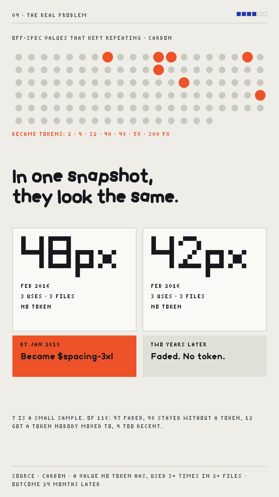

<p align="center"></p>

<h1 align="center">selfheal</h1>

<p align="center"><b>When does a hardcoded value earn a design token?</b><br>
An experiment on 11 years of the Carbon Design System's git history, plus a synthetic benchmark and frontier coding agents.</p>

<p align="center"><a href="share/selfheal-vertical.mp4"></a><br>
<sub>72-second video (click to play) · <a href="share/caption.md">post caption</a> · <a href="share/claims.md">every number, sourced</a></sub></p>

---

## The idea in one minute

Design systems drift. Someone types `48px` instead of using a spacing token. A "self-healing" system would notice
and fix it on its own. There are two very different kinds of drift, though:

1. **A slip.** `47px` where `$spacing-09` (48px) was meant. Fix: snap it to the token.
2. **A desire path.** The same "wrong" value keeps showing up because people need something the system doesn't
   have yet. Like the dirt trail people wear across a lawn, it's a signal, not a mistake. Fix: add the token.

In Carbon, `48px` was typed by hand 14 times across 10 files before `$spacing-3xl` (48px) was added in January 2018.
That was a desire path: the system caught up. The question this repo tests is whether a tool can tell the two apart
**before** the design system team does.

## What we found

| Test | Data | Result | Verdict |
|---|---|---|---|
| Snap a stray value to the right token | 157 real fixes mined from Carbon; 103 off-scale fixes across 10 systems | Nearest token = what the human picked, **153 of 157** in Carbon (134 were exact matches); **82%** on values genuinely off the scale | Solved for exact matches; ~4 in 5 for real near-misses. Context added nothing. |
| Same, for values halfway between two tokens | synthetic (5 generated repos) | **189 of 191** right when the model commits to a token | Solved |
| Tell a slip from a future token | 116 repeating off-spec values in Carbon | 7 became tokens. Calling every repeat "a new token" is right **13%** of the time (55% on synthetic) | **Open** |
| Add history: was it added in a burst, by few authors, did it survive? | Carbon + simulated history | Helped on simulated history (55% → 87%), **near chance on Carbon (13% → 14%)** | **Open** |
| Frontier coding agents on the whole task | synthetic, 5 repos, sandboxed | Opus 5.5 **96.9%**, Codex 91.4%, our model 89.7%, Sonnet 5.5 84.4% | The best agents already beat a purpose-built model |

**Takeaway (Carbon only; see the 15-system update below):** fixing slips is mostly solved, and the best agents already do it well. Knowing when a repeated value deserves
a token is still open: nothing in the code or its history predicted Carbon's 7 desire paths better than guessing.

Read the results with these limits in mind:
- **7 desire paths is a small sample**, all from 2015–2018 when Carbon was still building its scale.
- The **synthetic benchmark was written by the same person as the model**, so it flatters the model. Carbon is the headline.
- Mined labels are not perfect: a hand check of 20 found 4 wrong (all in "value changed" labels, which the 157 exclude).

### Update (6 Nov): three more design systems

- **Fixing drift replicates** on Shopify Polaris (13 of 14) and Elastic EUI (6 of 6). Small samples.
- **Carbon's "7 desire paths" were mostly one decision.** With a stricter definition of a token (a variable shared by
  3+ files), 5 of them arrived together when Carbon introduced its spacing scale in January 2018. Values mostly earn
  tokens in batches, when a team builds or rebuilds its scale and codifies what people already type.
- **How common a value is predicts whether it gets codified**: its share of all hand-typed values scores 0.87 AUC
  across Carbon and EUI (11 tokens vs 42 drift), and being on the 4px grid scores 0.74. (History signals are not yet
  re-tested under these labels.)
- **GitLab UI had nothing to mine**: it styles with utility classes, so hand-typed values never pile up.

Details: [`notes/step5.md`](notes/step5.md), rules in [`docs/mining.md`](docs/mining.md).

### Update (6 Nov, later): 15 design systems

Carbon, EUI, Bootstrap, Primer CSS, Material Components Web, Ant Design, GOV.UK Frontend, USWDS, Clarity, Spectrum CSS,
Foundation, Semantic UI, PatternFly, Salesforce Lightning and Blueprint.

- **Snapping is solved only for exact matches.** 695 of 798 drift fixes typed a value that already was a token's value.
  For values genuinely off the scale (103 fixes, 10 systems), the nearest token is the one the human picked
  **82% of the time** (95% CI 71–91%); nearby code in the same file doesn't improve it. The "153 of 157" above is
  accurate but 134 of those are exact matches.
- **How common a value is predicts whether it becomes a token, across systems.** Trained on 14 systems and tested on
  the 15th, a model using only a snapshot (uses, files, share of all typed values) ranks future tokens above drift
  with AUC 0.68–0.71. Git history (bursts, authors, survival) adds almost nothing.
- **Tokens arrive in batches**: 50 of 73 came in months when a team added 4 or more token values at once.

Details: [`notes/step6.md`](notes/step6.md).

The full write-up, with the reasoning and related work, is the "Self-Healing Design Systems" doc; `PLAN.md` logs every
decision with its date.

## How it works

- **Mining Carbon** (`src/mine.py`, `src/desire.py`, `src/clusters.py`, rules in [`docs/mining.md`](docs/mining.md)):
  a *drift fix* is a commit that replaces `prop: <literal>` with a token for the same property. An *off-spec
  cluster* is a value no token has, used 3+ times in 2+ files. It's a *desire path* if a token with that value
  appears within 24 months and the code moves onto it.
- **The model** (`src/detect.py`): each token is a fuzzy target. A value close to one token is probably a slip
  towards it. Nearby code (same component, same property) votes on which token was meant. A tight group of values no
  token explains becomes a proposed new token.
- **The healer** (`src/heal.py`, `src/iterate.py`): applies fixes and checks they're safe to re-run (fixing twice
  changes nothing; bound tokens are left alone).
- **Agents** (`scripts/run_agents2.sh`): Claude Code and Codex get the same repo, the same prompt and sandboxed code
  execution, and must write a fix-or-keep decision for every site. Answers are scored against the hidden truth.

## Run it

```sh
uv venv -p 3.12 .venv && VIRTUAL_ENV=.venv uv pip install numpy scipy scikit-learn
for s in 1 2 3 4 5; do .venv/bin/python src/gen.py $s data/s$s; done   # synthetic benchmark
cd src && ../.venv/bin/python bench.py                                  # all methods, 5 seeds

# Carbon (needs a clone of https://github.com/carbon-design-system/carbon; its path is `R` at the top of each Carbon script)
../.venv/bin/python mine.py && ../.venv/bin/python label_carbon.py && ../.venv/bin/python eval_mined.py
../.venv/bin/python desire.py && ../.venv/bin/python clusters.py && ../.venv/bin/python timefeat_carbon.py

# every number in the video, recomputed from the data (~4 min)
../.venv/bin/python ../share/recompute.py
```

The video is built in `share/video/` with the Remotion pipeline from [tasty_tunez](https://github.com/davidghatley/tasty_tunez)
(`./build.sh`; it expects `kit` to link to `tasty_tunez/promo`). `share/process.md` describes the steps.

## Layout

```
src/        benchmark generator, extraction, detectors, scoring, healer, Carbon mining, time features
scripts/    agent runs (prompts, sandboxed launch)
notes/      results as JSON, agent outputs, spot-check
docs/       mining rules and counts
share/      the video, stills, caption, claims table, and the recompute scripts
assets/     the glyph
```

`data/` (generated seeds, mined Carbon data) is not committed; the scripts above recreate it.

## Credits and license

Code: MIT, see [LICENSE](LICENSE). The labels are mined from the
[Carbon Design System](https://github.com/carbon-design-system/carbon) (© IBM, Apache-2.0); short excerpts of its
SCSS appear in `notes/spotcheck*`. Carbon's team didn't make this and doesn't endorse it. Video type and palette come
from tasty_tunez.
